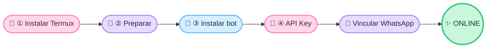

<!-- ╭──────────────────────────────────────────────╮
     │  ✿  Kiriti-Bot-MD · README kawaii edition  ✿  │
     ╰──────────────────────────────────────────────╯ -->

<div align="center">


<picture>
  <source media="(prefers-color-scheme: dark)" srcset="https://dix.lat/logo.svg?788">
  <source media="(prefers-color-scheme: light)" srcset="https://cdn.dix.lat/me/0lkj_20260829-c91x-2p9h-f407.png">
  
</picture>

<br/>

<a href="#instalacion">
  
</a>

<br/>


<a href="https://github.com/eliac-d/dix-bot/stargazers"></a>
<a href="https://github.com/eliac-d/dix-bot/network/members"></a>


</div>

<br/>

<!-- ─────────────── MENÚ PRINCIPAL ─────────────── -->

<div align="center">

### ˚₊‧꒰ა ✧ Menú principal ✧ ໒꒱ ‧₊˚

<table>
  <tr>
    <td align="center" width="16%">
      <a href="#que-es">
        <br/>
        <sub><b>¿Qué es?</b></sub>
      </a>
    </td>
    <td align="center" width="16%">
      <a href="#funciones">
        <br/>
        <sub><b>Funciones</b></sub>
      </a>
    </td>
    <td align="center" width="16%">
      <a href="#instalacion">
        <br/>
        <sub><b>Instalar</b></sub>
      </a>
    </td>
    <td align="center" width="16%">
      <a href="#usar">
        <br/>
        <sub><b>Cómo usar</b></sub>
      </a>
    </td>
    <td align="center" width="16%">
      <a href="#siempre-activo">
        <br/>
        <sub><b>24/7</b></sub>
      </a>
    </td>
    <td align="center" width="16%">
      <a href="#ayuda">
        <br/>
        <sub><b>Ayuda</b></sub>
      </a>
    </td>
  </tr>
</table>

</div>


<a id="que-es"></a>

##  ¿Qué es Kiriti-Bot?

<table>
<tr>
<td>

**Kiriti-Bot** es un ayudante que vive dentro de un número de WhatsApp ✿ Le escribes un comando como `#menu` o `#s` y él te responde al instante: hace **stickers**, descarga **música y videos**, juega contigo, modera tus **grupos** y hasta conversa con **inteligencia artificial**.

> 🌸 **No necesitas saber programar.** Esta guía está pensada para que cualquier persona lo instale copiando y pegando, paso a paso.

</td>
</tr>
</table>

> [!TIP]
> 💖 **¿Tienes prisa?** Solo sigue los pasos **① → ② → ③ → ④** de la [instalación](#instalacion). Todo lo demás está guardadito en menús plegables para cuando lo necesites.


<a id="funciones"></a>

##  Todo lo que sabe hacer

<div align="center">

<table>
  <tr>
    <td align="center" width="33%">
      <h3>🎀 Stickers</h3>
      <sub>Convierte fotos y videos en stickers, mezcla emojis y crea citas bonitas</sub><br/><br/>
      <code>#s</code> <code>#emojimix</code> <code>#qc</code>
    </td>
    <td align="center" width="33%">
      <h3>🎧 Descargas</h3>
      <sub>Música y videos de YouTube, TikTok, Instagram, Facebook, Spotify, X y más</sub><br/><br/>
      <code>#play</code> <code>#tt</code> <code>#ig</code>
    </td>
    <td align="center" width="33%">
      <h3>🤖 Inteligencia artificial</h3>
      <sub>Chatea con IA, crea imágenes desde texto y genera notas de voz</sub><br/><br/>
      <code>#ia</code> <code>#aimg</code> <code>#voice</code>
    </td>
  </tr>
  <tr>
    <td align="center">
      <h3>🌸 Anime</h3>
      <sub>Reacciones animadas: abrazos, besos, risas, llanto y muchas más</sub><br/><br/>
      <code>#hug</code> <code>#kiss</code> <code>#happy</code>
    </td>
    <td align="center">
      <h3>💞 Gacha waifus</h3>
      <sub>Colecciona personajes, arma tu harem y vota por tus favoritos</sub><br/><br/>
      <code>#rollwaifu</code> <code>#claim</code> <code>#harem</code>
    </td>
    <td align="center">
      <h3>🎮 Juegos</h3>
      <sub>Trivia, ahorcado, piedra-papel-tijera, Akinator, tres en raya…</sub><br/><br/>
      <code>#ppt</code> <code>#trivia</code> <code>#aki</code>
    </td>
  </tr>
  <tr>
    <td align="center">
      <h3>🛡️ Grupos</h3>
      <sub>Antilink, antispam, advertencias, bienvenidas y menciones a todos</sub><br/><br/>
      <code>#tag</code> <code>#warn</code> <code>#cerrar</code>
    </td>
    <td align="center">
      <h3>🧰 Herramientas</h3>
      <sub>Traductor, clima, códigos QR, texto a voz, reconocer canciones…</sub><br/><br/>
      <code>#trt</code> <code>#clima</code> <code>#shazam</code>
    </td>
    <td align="center">
      <h3>🔍 Búsquedas</h3>
      <sub>Pinterest, Wikipedia, YouTube, imágenes de Google y más</sub><br/><br/>
      <code>#pin</code> <code>#yts</code> <code>#wikipedia</code>
    </td>
  </tr>
  <tr>
    <td align="center">
      <h3>✨ Diversión</h3>
      <sub>Memes, frases, poemas, la bola 8 mágica y parejas del grupo</sub><br/><br/>
      <code>#meme</code> <code>#8ball</code> <code>#top</code>
    </td>
    <td align="center">
      <h3>💌 Social</h3>
      <sub>Tu perfil personal dentro del bot, ¡y hasta casarte con alguien!</sub><br/><br/>
      <code>#perfil</code> <code>#marry</code>
    </td>
    <td align="center">
      <h3>🐰 Sub-bots</h3>
      <sub>Convierte otros números en bots hijos conectados al principal</sub><br/><br/>
      <code>#serbot</code> <code>#bots</code>
    </td>
  </tr>
</table>

<sub>✧ Escribe <code>#menu</code> en WhatsApp para ver la lista completa de más de 150 comandos ✧</sub>

</div>


##  Lo que necesitas

<div align="center">

<table>
  <tr>
    <td align="center" width="33%">
      <br/>
      <b>Un celular Android</b><br/>
      <sub>¡El que ya tienes sirve!</sub>
    </td>
    <td align="center" width="33%">
      <br/>
      <b>Una API Key gratis</b><br/>
      <sub>Se saca en <a href="https://dix.lat/login">dix.lat/login</a></sub>
    </td>
    <td align="center" width="33%">
      <br/>
      <b>Un número de WhatsApp</b><br/>
      <sub>Mejor uno distinto al personal</sub>
    </td>
  </tr>
</table>

</div>


<a id="instalacion"></a>

##  Instalación en Android



<br/>

### 🌸 ① Instalar Termux

<details open>
<summary><b>✿ Ver pasos</b></summary>

<br/>

Termux es una app gratuita que permite que tu celular ejecute el bot. Piensa en ella como la "casita" donde vivirá Kiriti 🏡

> [!WARNING]
> 🚫 **No la descargues de Google Play.** Esa versión está vieja y rompe la instalación.

Descárgala desde aquí:

<a href="https://f-droid.org/packages/com.termux/"></a>
<a href="https://github.com/termux/termux-app/releases/latest"></a>

Instálala y ábrela. Verás una pantalla negra con letras: ¡es normal! ✨

</details>

### 🍡 ② Preparar Termux

<details open>
<summary><b>✿ Ver comandos</b></summary>

<br/>

> 💡 **Cómo pegar en Termux:** mantén el dedo presionado sobre la pantalla → toca **Paste**.

**Paso A** · Actualiza todo (si te pregunta algo, presiona **Enter** o escribe `y`):

```bash
pkg update -y && pkg upgrade -y
```

**Paso B** · Instala las herramientas necesarias:

```bash
pkg install -y git nodejs
```

**Paso C** · Revisa la versión:

```bash
node -v
```

✅ Debe aparecer `v22` o un número mayor.

> [!NOTE]
> Si sale un número menor, ejecuta `pkg upgrade -y` y vuelve a revisar.

</details>

### 🚀 ③ Instalar y encender el bot

<details open>
<summary><b>✿ Ver el comando mágico</b></summary>

<br/>

Copia **todo** este comando de una sola vez. Descarga, instala y enciende el bot automáticamente 🪄

```bash
git clone https://github.com/eliac-d/dix-bot.git && cd dix-bot && npm install && npm start
```

☕ Espera unos minutitos. Cuando termine, verás el mensaje de bienvenida de Kiriti.

</details>

### 🔑 ④ Primera configuración

<details open>
<summary><b>✿ API Key y vincular WhatsApp</b></summary>

<br/>

#### 🗝️ 4.1 · Tu API Key

| | |
|:--:|:--|
| **1** | Entra a [dix.lat/login](https://dix.lat/login) desde tu navegador |
| **2** | Crea tu cuenta o inicia sesión |
| **3** | Copia tu clave (empieza con `dix_`) |
| **4** | Vuelve a Termux, pégala y presiona **Enter** |

💾 El bot la guarda y no te la vuelve a pedir.

#### 💌 4.2 · Vincular WhatsApp

Escribe el número del bot **con código de país**, sin `+` ni espacios:

```text
Ejemplo para Honduras → 50499999999
Ejemplo para Perú     → 51999999999
```

Aparecerá un **código de 8 dígitos**. Ahora abre WhatsApp en el celular de ese número:

```text
⚙️ Ajustes → 🔗 Dispositivos vinculados → ➕ Vincular un dispositivo
→ 📞 Vincular con número de teléfono → escribe el código
```

🎉 Cuando Termux muestre **`ONLINE`**, ¡Kiriti ya está vivo!

> [!CAUTION]
> No cierres Termux durante la vinculación. Si se interrumpe, borra la carpeta `sessions/main` y repite este paso.

</details>


<a id="usar"></a>

##  Cómo usarlo en WhatsApp

Todos los comandos empiezan con un símbolo. Puedes usar cualquiera de estos: **`#`** **`!`** **`.`** **`/`**

<div align="center">

| 💬 Escribe esto | ✨ Y pasa esto |
|:--|:--|
| `#menu` | Te muestra todos los comandos 📜 |
| `#ping` | Comprueba que el bot está despierto 🏓 |
| `#s` *(respondiendo a una foto)* | Convierte la foto en sticker 🎀 |
| `#play nombre de canción` | Te envía la canción en audio 🎧 |
| `#tt enlace de TikTok` | Descarga el video sin marca de agua 🎬 |
| `#ia pregunta` | Responde con inteligencia artificial 🤖 |
| `#rollwaifu` | Te sale un personaje aleatorio 💞 |
| `#hug @amigo` | Le envía un abrazo animado 🫂 |

</div>


<a id="siempre-activo"></a>

##  Mantenerlo activo 24/7

<details>
<summary><b>🔋 Evitar que Android apague el bot</b></summary>

<br/>

Primero detén el bot con <kbd>Ctrl</kbd> + <kbd>C</kbd> (en Termux: botón `CTRL` + `C`, o `Volumen abajo + C`).

Instala **PM2**, el "guardián" que mantiene a Kiriti despierto:

```bash
npm install -g pm2
pm2 start npm --name kiriti -- start
pm2 save
```

Luego aplica estos tres cuidados 💤:

```bash
termux-wake-lock
```

- 🔋 Batería: **Ajustes → Apps → Termux → Batería → Sin restricciones**
- 🙅 No cierres Termux desde las apps recientes

</details>

<details>
<summary><b>🔁 Que se encienda solo al reiniciar el celular</b></summary>

<br/>

Instala [Termux:Boot](https://f-droid.org/packages/com.termux.boot/), ábrelo **una vez** y ejecuta:

```bash
mkdir -p ~/.termux/boot
cat > ~/.termux/boot/kiriti.sh << 'EOS'
#!/data/data/com.termux/files/usr/bin/sh
termux-wake-lock
pm2 resurrect
EOS
chmod +x ~/.termux/boot/kiriti.sh
```

</details>

### 🎛️ Control remoto del bot

<div align="center">

| | Quiero… | Comando |
|:--:|:--|:--|
| 🟢 | Ver si está encendido | `pm2 status` |
| 👀 | Ver qué está pasando | `pm2 logs kiriti` |
| 🔄 | Reiniciarlo | `pm2 restart kiriti` |
| 🔴 | Apagarlo | `pm2 stop kiriti` |
| ⬆️ | Actualizarlo | `cd dix-bot && git pull && npm install && pm2 restart kiriti` |

</div>


<a id="ayuda"></a>

##  ¿Algo salió mal? No pasa nada (｡•́︿•̀｡)

<details>
<summary><b>💥 Sale error al ejecutar <code>npm install</code></b></summary>

<br/>

```bash
pkg install -y python make clang
npm install
```

</details>

<details>
<summary><b>📉 Node.js es menor a la versión 22</b></summary>

<br/>

```bash
pkg upgrade -y
```

Vuelve a comprobar con `node -v`.

</details>

<details>
<summary><b>🔑 Mi API Key no funciona</b></summary>

<br/>

Cópiala completa desde [dix.lat/login](https://dix.lat/login). Debe verse así: `dix_xxxxxxxxxxxxxxxx`, sin espacios ni saltos de línea.

</details>

<details>
<summary><b>♻️ Quiero cambiar la API Key</b></summary>

<br/>

```bash
pm2 stop kiriti
rm sessions/apikey.json
npm start
```

Al terminar, detén con <kbd>Ctrl</kbd> + <kbd>C</kbd> y vuelve a iniciar:

```bash
pm2 start kiriti
```

</details>

<details>
<summary><b>📱 Quiero vincular otro número de WhatsApp</b></summary>

<br/>

```bash
pm2 stop kiriti
rm -rf sessions/main
npm start
```

</details>

<details>
<summary><b>😴 El bot deja de responder después de unas horas</b></summary>

<br/>

Comprueba que el bloqueo esté activo:

```bash
termux-wake-lock
```

Y que Termux tenga la batería en **Sin restricciones**.

</details>


##  Otros lugares donde puede vivir

<div align="center">

| Entorno | | Ideal para |
|:--|:--:|:--|
| 📱 Android · Termux | 💖 | Empezar rápido con tu propio celular |
| 🐧 Linux · Debian, Ubuntu, Arch, Alpine | ✅ | Servidores y equipos dedicados |
| ☁️ VPS o máquina virtual | ✅ | Funcionar sin parar con systemd o PM2 |
| 🐳 Docker o Podman | ✅ | Instalaciones aisladas y reproducibles |
| 🍎 macOS | ✅ | Desarrollo y pruebas |
| 🪟 Windows · WSL2 | ✅ | Desarrollo y pruebas |

</div>

<details>
<summary><b>🐧 Linux · Debian, Ubuntu, Arch, Alpine</b></summary>

<br/>

**Node.js 22 con NodeSource (Debian / Ubuntu):**

```bash
sudo apt update
sudo apt install -y git curl build-essential
curl -fsSL https://deb.nodesource.com/setup_22.x | sudo -E bash -
sudo apt install -y nodejs
```

**Arch:**

```bash
sudo pacman -S git nodejs npm
```

**Alpine:**

```bash
sudo apk add git nodejs npm
```

Después instala el bot igual que en el paso ③:

```bash
git clone https://github.com/eliac-d/dix-bot.git && cd dix-bot && npm install && npm start
```

</details>

<details>
<summary><b>🍎 macOS</b></summary>

<br/>

```bash
brew install node@22 git
```

O con nvm:

```bash
curl -o- https://raw.githubusercontent.com/nvm-sh/nvm/v0.39.7/install.sh | bash
nvm install 22 && nvm use 22
```

</details>

<details>
<summary><b>🪟 Windows · WSL2</b></summary>

<br/>

En PowerShell con permisos de administrador:

```powershell
wsl --install -d Ubuntu
```

Dentro de Ubuntu, sigue los pasos de **Linux · Debian, Ubuntu, Arch, Alpine**.

</details>

<details>
<summary><b>🐳 Docker o Podman</b></summary>

<br/>

Crea el contenedor:

```bash
docker run -it --name kiriti \
  -v "$PWD/sessions:/app/sessions" \
  -w /app \
  node:22 bash
```

Dentro del contenedor:

```bash
git clone https://github.com/eliac-d/dix-bot.git .
npm install
npm start
```

La carpeta `sessions/` guarda la API Key y la sesión de WhatsApp entre reinicios.

</details>

<details>
<summary><b>☁️ VPS o máquina virtual · systemd</b></summary>

<br/>

Recomendado si quieres que el bot arranque solo junto con el sistema.

Crea el archivo `/etc/systemd/system/kiriti.service`:

```ini
[Unit]
Description=Kiriti-Bot-MD - WhatsApp Bot
After=network-online.target
Wants=network-online.target

[Service]
Type=simple
User=TU_USUARIO
WorkingDirectory=/ruta/a/dix-bot
ExecStart=/usr/bin/npm start
Restart=always
RestartSec=10

[Install]
WantedBy=multi-user.target
```

Actívalo:

```bash
sudo systemctl daemon-reload
sudo systemctl enable --now kiriti
sudo systemctl status kiriti
```

Ver los registros en tiempo real:

```bash
journalctl -u kiriti -f
```

</details>

<details>
<summary><b>☁️ VPS o VM con PM2 en vez de systemd</b></summary>

<br/>

```bash
npm install -g pm2
pm2 start npm --name kiriti -- start
pm2 startup
pm2 save
```

Ejecuta el comando que `pm2 startup` muestre en pantalla antes de `pm2 save`.

</details>


##  Uso responsable

> [!IMPORTANT]
> 🌷 Kiriti-Bot es un proyecto de código abierto, **no afiliado a Meta ni a WhatsApp**. Úsalo con cariño: nada de spam, respeta a las personas de tus grupos y los Términos de Servicio de WhatsApp.

<br/>

<div align="center">


### ¡Gracias por usar Kiriti-Bot! ˚ʚ♡ɞ˚

<sub>Si te gustó, regálale una ⭐ al repositorio, ¡nos hace muy felices!</sub>

<br/><br/>

<a href="https://dix.lat"></a>
<a href="https://github.com/eliac-d/dix-bot"></a>
<a href="https://dix.lat/login"></a>

<br/><br/>

<sub>Desarrollado y mantenido con ♡ por <strong>Dix System</strong></sub>

<br/>

<a href="https://dix.lat">
  <picture>
    <source media="(prefers-color-scheme: dark)" srcset="https://dix.lat/icon.svg?67">
    <source media="(prefers-color-scheme: light)" srcset="https://cdn.dix.lat/me/0lkj_20260829-c91x-2p9h-f407.png">
    
  </picture>
</a>


</div>
