<!-- ◆ Kiriti-Bot-MD · README · Edición Black Swordsman ◆ -->

<div align="center">


<br/>

<picture>
  <source media="(prefers-color-scheme: dark)" srcset="https://dix.lat/logo.svg?788">
  <source media="(prefers-color-scheme: light)" srcset="https://cdn.dix.lat/me/0lkj_20260829-c91x-2p9h-f407.png">
  
</picture>

<br/>

<a href="#instalacion">
  
</a>

<br/><br/>


<a href="https://github.com/eliac-d/dix-bot/stargazers"></a>
<a href="https://github.com/eliac-d/dix-bot/network/members"></a>


<br/><br/>



</div>

<br/>

<!-- ─────────────── MAIN MENU ─────────────── -->

<div align="center">

<h3>◆ &nbsp; M A I N &nbsp; M E N U &nbsp; ◆</h3>

<table>
  <tr>
    <td align="center" width="33%">
      <a href="#que-es"></a><br/>
      <sub>Qué es Kiriti-Bot</sub>
    </td>
    <td align="center" width="33%">
      <a href="#habilidades"></a><br/>
      <sub>Todo lo que puede hacer</sub>
    </td>
    <td align="center" width="33%">
      <a href="#instalacion"></a><br/>
      <sub>Instalación paso a paso</sub>
    </td>
  </tr>
  <tr>
    <td align="center">
      <a href="#usar"></a><br/>
      <sub>Cómo usarlo en WhatsApp</sub>
    </td>
    <td align="center">
      <a href="#siempre-activo"></a><br/>
      <sub>Que nunca se apague</sub>
    </td>
    <td align="center">
      <a href="#soporte"></a><br/>
      <sub>Solución de problemas</sub>
    </td>
  </tr>
</table>

</div>


<a id="que-es"></a>

## ◈ Sistema · ¿Qué es Kiriti-Bot?

**Kiriti-Bot** es un asistente que vive dentro de un número de WhatsApp. Le escribes un comando como `#menu` y responde al instante: crea **stickers**, descarga **música y videos**, modera **grupos**, ofrece **juegos** y conversa con **inteligencia artificial**.

> [!TIP]
> **▸ No necesitas saber programar.** Sigue los pisos **01 → 02 → 03 → 04** de la [instalación](#instalacion) copiando y pegando. Lo avanzado está guardado en menús plegables.


<a id="habilidades"></a>

## ⚔ Habilidades del sistema

<div align="center">

<table>
  <tr>
    <td width="33%" valign="top">
      <b>▣ &nbsp;STICKERS</b><br/>
      <sub>Fotos y videos a sticker, mezcla de emojis y citas con estilo.</sub><br/><br/>
      <code>#s</code> <code>#emojimix</code> <code>#qc</code>
    </td>
    <td width="33%" valign="top">
      <b>⇩ &nbsp;DESCARGAS</b><br/>
      <sub>YouTube, TikTok, Instagram, Facebook, Spotify, X y más.</sub><br/><br/>
      <code>#play</code> <code>#tt</code> <code>#ig</code>
    </td>
    <td width="33%" valign="top">
      <b>✵ &nbsp;INTELIGENCIA ARTIFICIAL</b><br/>
      <sub>Chat con IA, imágenes desde texto y notas de voz.</sub><br/><br/>
      <code>#ia</code> <code>#aimg</code> <code>#voice</code>
    </td>
  </tr>
  <tr>
    <td valign="top">
      <b>⛨ &nbsp;GRUPOS</b><br/>
      <sub>Antilink, antispam, advertencias, bienvenidas y menciones.</sub><br/><br/>
      <code>#tag</code> <code>#warn</code> <code>#cerrar</code>
    </td>
    <td valign="top">
      <b>⚒ &nbsp;HERRAMIENTAS</b><br/>
      <sub>Traductor, clima, códigos QR, texto a voz, reconocer canciones.</sub><br/><br/>
      <code>#trt</code> <code>#clima</code> <code>#shazam</code>
    </td>
    <td valign="top">
      <b>⌕ &nbsp;BÚSQUEDAS</b><br/>
      <sub>Pinterest, Wikipedia, YouTube e imágenes.</sub><br/><br/>
      <code>#pin</code> <code>#yts</code> <code>#wiki</code>
    </td>
  </tr>
  <tr>
    <td valign="top">
      <b>◇ &nbsp;ANIME</b><br/>
      <sub>Reacciones animadas: abrazos, besos, risas y más.</sub><br/><br/>
      <code>#hug</code> <code>#kiss</code> <code>#happy</code>
    </td>
    <td valign="top">
      <b>♛ &nbsp;GACHA</b><br/>
      <sub>Colecciona personajes, arma tu harem y vota por favoritos.</sub><br/><br/>
      <code>#rollwaifu</code> <code>#claim</code> <code>#harem</code>
    </td>
    <td valign="top">
      <b>♟ &nbsp;JUEGOS</b><br/>
      <sub>Trivia, ahorcado, piedra-papel-tijera, Akinator, tres en raya.</sub><br/><br/>
      <code>#ppt</code> <code>#trivia</code> <code>#aki</code>
    </td>
  </tr>
  <tr>
    <td valign="top">
      <b>✧ &nbsp;DIVERSIÓN</b><br/>
      <sub>Memes, frases, poemas, bola 8 y tops del grupo.</sub><br/><br/>
      <code>#meme</code> <code>#8ball</code> <code>#top</code>
    </td>
    <td valign="top">
      <b>♡ &nbsp;SOCIAL</b><br/>
      <sub>Perfil de jugador dentro del bot y matrimonios.</sub><br/><br/>
      <code>#perfil</code> <code>#marry</code>
    </td>
    <td valign="top">
      <b>↯ &nbsp;SUB-BOTS</b><br/>
      <sub>Conecta otros números como bots enlazados al principal.</sub><br/><br/>
      <code>#serbot</code> <code>#bots</code>
    </td>
  </tr>
</table>

<sub>▸ Escribe <code>#menu</code> en WhatsApp para ver los más de 150 comandos</sub>

</div>


## ◆ Equipo necesario

<div align="center">

| | Ítem | Dónde conseguirlo |
|:--:|:--|:--|
| **I** | Celular Android | El que ya tienes |
| **II** | API Key gratuita | [dix.lat/login](https://dix.lat/login) |
| **III** | Número de WhatsApp | Recomendado: distinto al personal |

</div>


<a id="instalacion"></a>

## ▸ Link Start · Instalación en Android


<br/>

### ◆ FLOOR 01 · Instalar Termux

<details open>
<summary><b>▸ Ver pasos</b></summary>

<br/>

Termux es una app gratuita que permite a tu celular ejecutar el bot. Es la base donde vivirá Kiriti.

> [!WARNING]
> **No la descargues de Google Play.** Esa versión está desactualizada y rompe la instalación.

<a href="https://f-droid.org/packages/com.termux/"></a>
<a href="https://github.com/termux/termux-app/releases/latest"></a>

Instálala y ábrela. Verás una pantalla negra con texto: es lo normal.

</details>

### ◆ FLOOR 02 · Preparar Termux

<details open>
<summary><b>▸ Ver comandos</b></summary>

<br/>

> **Cómo pegar en Termux:** mantén el dedo presionado sobre la pantalla → toca **Paste**.

**A ·** Actualiza el sistema (si pregunta algo, presiona **Enter** o escribe `y`):

```bash
pkg update -y && pkg upgrade -y
```

**B ·** Instala las herramientas:

```bash
pkg install -y git nodejs
```

**C ·** Comprueba la versión:

```bash
node -v
```

Debe mostrar `v22` o superior.

> [!NOTE]
> Si muestra una versión menor, ejecuta `pkg upgrade -y` y vuelve a comprobar.

</details>

### ◆ FLOOR 03 · Instalar y encender el bot

<details open>
<summary><b>▸ Ver comando</b></summary>

<br/>

Copia el comando **completo**. Descarga, instala y enciende el bot automáticamente:

```bash
git clone https://github.com/eliac-d/dix-bot.git && cd dix-bot && npm install && npm start
```

Espera unos minutos. Al terminar, verás el mensaje de bienvenida del bot.

</details>

### ◆ FLOOR 04 · Primera configuración

<details open>
<summary><b>▸ API Key y vinculación de WhatsApp</b></summary>

<br/>

#### 4.1 · API Key

| Paso | Acción |
|:--:|:--|
| **1** | Entra a [dix.lat/login](https://dix.lat/login) desde el navegador |
| **2** | Crea tu cuenta o inicia sesión |
| **3** | Copia tu clave (empieza con `dix_`) |
| **4** | Vuelve a Termux, pégala y presiona **Enter** |

El bot la guarda y no la vuelve a pedir.

#### 4.2 · Vincular WhatsApp

Escribe el número del bot **con código de país**, sin `+` ni espacios:

```text
Honduras  →  50499999999
Perú      →  51999999999
```

Aparecerá un **código de 8 dígitos**. En el WhatsApp de ese número:

```text
Ajustes → Dispositivos vinculados → Vincular un dispositivo
→ Vincular con número de teléfono → escribe el código
```

Cuando Termux muestre **`ONLINE`**, el bot ya está en línea.

> [!CAUTION]
> No cierres Termux durante la vinculación. Si se interrumpe, borra `sessions/main` y repite este paso.

</details>


<a id="usar"></a>

## ✦ Comandos en WhatsApp

Todos los comandos empiezan con un prefijo. Puedes usar cualquiera: **`#`** &nbsp; **`!`** &nbsp; **`.`** &nbsp; **`/`**

<div align="center">

| Escribe | Resultado |
|:--|:--|
| `#menu` | Muestra todos los comandos |
| `#ping` | Comprueba que el bot responde |
| `#s` *(respondiendo a una foto)* | Convierte la foto en sticker |
| `#play nombre de la canción` | Envía la canción en audio |
| `#tt enlace de TikTok` | Descarga el video |
| `#ia tu pregunta` | Responde con inteligencia artificial |
| `#rollwaifu` | Obtienes un personaje aleatorio |
| `#hug @usuario` | Envía un abrazo animado |

</div>


<a id="siempre-activo"></a>

## ◉ Modo 24/7

<details>
<summary><b>▸ Evitar que Android apague el bot</b></summary>

<br/>

Detén el bot con <kbd>Ctrl</kbd> + <kbd>C</kbd> (en Termux: botón `CTRL` + `C`, o `Volumen abajo + C`).

Instala **PM2**, el guardián que mantiene el bot encendido:

```bash
npm install -g pm2
pm2 start npm --name kiriti -- start
pm2 save
```

Después aplica estos tres ajustes:

```bash
termux-wake-lock
```

- Batería: **Ajustes → Apps → Termux → Batería → Sin restricciones**
- No cierres Termux desde las apps recientes

</details>

<details>
<summary><b>▸ Encender automáticamente al reiniciar el celular</b></summary>

<br/>

Instala [Termux:Boot](https://f-droid.org/packages/com.termux.boot/), ábrelo **una vez** y ejecuta:

```bash
mkdir -p ~/.termux/boot
cat > ~/.termux/boot/kiriti.sh << 'EOS'
#!/data/data/com.termux/files/usr/bin/sh
termux-wake-lock
pm2 resurrect
EOS
chmod +x ~/.termux/boot/kiriti.sh
```

</details>

### ◆ Panel de control

<div align="center">

| | Acción | Comando |
|:--:|:--|:--|
| ◉ | Ver si está encendido | `pm2 status` |
| ◎ | Ver la actividad | `pm2 logs kiriti` |
| ↻ | Reiniciar | `pm2 restart kiriti` |
| ■ | Apagar | `pm2 stop kiriti` |
| ⇧ | Actualizar | `cd dix-bot && git pull && npm install && pm2 restart kiriti` |

</div>


<a id="soporte"></a>

## ⚙ Soporte del sistema

<details>
<summary><b>▸ Error al ejecutar <code>npm install</code></b></summary>

<br/>

```bash
pkg install -y python make clang
npm install
```

</details>

<details>
<summary><b>▸ Node.js es menor a la versión 22</b></summary>

<br/>

```bash
pkg upgrade -y
```

Vuelve a comprobar con `node -v`.

</details>

<details>
<summary><b>▸ Mi API Key no funciona</b></summary>

<br/>

Cópiala completa desde [dix.lat/login](https://dix.lat/login). Debe verse así: `dix_xxxxxxxxxxxxxxxx`, sin espacios ni saltos de línea.

</details>

<details>
<summary><b>▸ Quiero cambiar la API Key</b></summary>

<br/>

```bash
pm2 stop kiriti
rm sessions/apikey.json
npm start
```

Al terminar, detén con <kbd>Ctrl</kbd> + <kbd>C</kbd> y vuelve a iniciar:

```bash
pm2 start kiriti
```

</details>

<details>
<summary><b>▸ Quiero vincular otro número de WhatsApp</b></summary>

<br/>

```bash
pm2 stop kiriti
rm -rf sessions/main
npm start
```

</details>

<details>
<summary><b>▸ El bot deja de responder después de unas horas</b></summary>

<br/>

Comprueba que el bloqueo esté activo:

```bash
termux-wake-lock
```

Y que Termux tenga la batería en **Sin restricciones**.

</details>


## ◇ Otros servidores

<div align="center">

| Entorno | Estado | Ideal para |
|:--|:--:|:--|
| Android · Termux | ◆ | Empezar rápido con tu propio celular |
| Linux · Debian, Ubuntu, Arch, Alpine | ✓ | Servidores y equipos dedicados |
| VPS o máquina virtual | ✓ | Operación continua con systemd o PM2 |
| Docker o Podman | ✓ | Despliegues aislados y reproducibles |
| macOS | ✓ | Desarrollo y pruebas |
| Windows · WSL2 | ✓ | Desarrollo y pruebas |

</div>

<details>
<summary><b>▸ Linux · Debian, Ubuntu, Arch, Alpine</b></summary>

<br/>

**Node.js 22 con NodeSource (Debian / Ubuntu):**

```bash
sudo apt update
sudo apt install -y git curl build-essential
curl -fsSL https://deb.nodesource.com/setup_22.x | sudo -E bash -
sudo apt install -y nodejs
```

**Arch:**

```bash
sudo pacman -S git nodejs npm
```

**Alpine:**

```bash
sudo apk add git nodejs npm
```

Después instala el bot igual que en el FLOOR 03:

```bash
git clone https://github.com/eliac-d/dix-bot.git && cd dix-bot && npm install && npm start
```

</details>

<details>
<summary><b>▸ macOS</b></summary>

<br/>

```bash
brew install node@22 git
```

O con nvm:

```bash
curl -o- https://raw.githubusercontent.com/nvm-sh/nvm/v0.39.7/install.sh | bash
nvm install 22 && nvm use 22
```

</details>

<details>
<summary><b>▸ Windows · WSL2</b></summary>

<br/>

En PowerShell con permisos de administrador:

```powershell
wsl --install -d Ubuntu
```

Dentro de Ubuntu, sigue los pasos de **Linux · Debian, Ubuntu, Arch, Alpine**.

</details>

<details>
<summary><b>▸ Docker o Podman</b></summary>

<br/>

Crea el contenedor:

```bash
docker run -it --name kiriti \
  -v "$PWD/sessions:/app/sessions" \
  -w /app \
  node:22 bash
```

Dentro del contenedor:

```bash
git clone https://github.com/eliac-d/dix-bot.git .
npm install
npm start
```

La carpeta `sessions/` guarda la API Key y la sesión de WhatsApp entre reinicios.

</details>

<details>
<summary><b>▸ VPS o máquina virtual · systemd</b></summary>

<br/>

Recomendado si quieres que el bot arranque junto con el sistema operativo.

Crea el archivo `/etc/systemd/system/kiriti.service`:

```ini
[Unit]
Description=Kiriti-Bot-MD - WhatsApp Bot
After=network-online.target
Wants=network-online.target

[Service]
Type=simple
User=TU_USUARIO
WorkingDirectory=/ruta/a/dix-bot
ExecStart=/usr/bin/npm start
Restart=always
RestartSec=10

[Install]
WantedBy=multi-user.target
```

Actívalo:

```bash
sudo systemctl daemon-reload
sudo systemctl enable --now kiriti
sudo systemctl status kiriti
```

Ver los registros en tiempo real:

```bash
journalctl -u kiriti -f
```

</details>

<details>
<summary><b>▸ VPS o VM con PM2 en vez de systemd</b></summary>

<br/>

```bash
npm install -g pm2
pm2 start npm --name kiriti -- start
pm2 startup
pm2 save
```

Ejecuta el comando que `pm2 startup` muestre en pantalla antes de `pm2 save`.

</details>


## ⛨ Código de honor

> [!IMPORTANT]
> Kiriti-Bot es un proyecto de código abierto, **no afiliado a Meta ni a WhatsApp**. Úsalo con responsabilidad: sin spam, con respeto a los miembros de tus grupos y a los Términos de Servicio de WhatsApp.

<br/>

<div align="center">

<a href="https://dix.lat"></a>
<a href="https://github.com/eliac-d/dix-bot"></a>
<a href="https://dix.lat/login"></a>

<br/><br/>

<sub>Si el proyecto te sirve, apóyalo con una ⭐ en el repositorio.</sub>

<br/><br/>

<sub>Desarrollado y mantenido por <strong>Dix System</strong></sub>

<br/>

<a href="https://dix.lat">
  <picture>
    <source media="(prefers-color-scheme: dark)" srcset="https://dix.lat/icon.svg?67">
    <source media="(prefers-color-scheme: light)" srcset="https://cdn.dix.lat/me/0lkj_20260829-c91x-2p9h-f407.png">
    
  </picture>
</a>

<br/>


</div>
