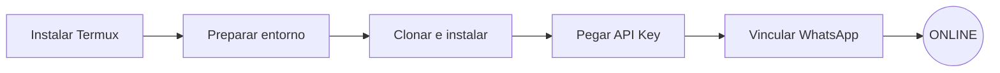

<div align="center">

<picture>
  <source media="(prefers-color-scheme: dark)" srcset="https://dix.lat/logo.svg?788">
  <source media="(prefers-color-scheme: light)" srcset="https://cdn.dix.lat/me/0lkj_20260829-c91x-2p9h-f407.png">
  
</picture>

<br/>
<br/>

# Kiriti-Bot-MD

**Bot de WhatsApp en Node.js, rápido, ligero y listo para correr 24/7.**
<br/>
Instálalo en tu celular Android, un servidor, una VM o un contenedor en minutos.

<br/>

<a href="https://github.com/eliac-d/dix-bot/stargazers"></a>
<a href="https://github.com/eliac-d/dix-bot/network/members"></a>
<a href="https://dix.lat/login"></a>
<a href="https://github.com/eliac-d/dix-bot"></a>


<br/>
<br/>

[Requisitos](#requisitos) · [Instalación](#instalación-en-android) · [24/7](#mantener-activo-247) · [Comandos](#comandos) · [Problemas](#solución-de-problemas) · [Otros entornos](#otros-entornos)

</div>

<br/>

> [!TIP]
> **¿Solo quieres instalarlo en tu celular?** Sigue los pasos **1 → 2 → 3 → 4** y listo. Todo lo demás está plegado para que lo abras solo si lo necesitas.

<br/>

## De cero a online



<br/>

## Compatibilidad

| Entorno | Soporte | Recomendado para |
|:--|:--:|:--|
| Android · Termux | ✅ | Empezar rápido con tu propio celular |
| Linux · Debian, Ubuntu, Arch, Alpine | ✅ | Servidores y equipos dedicados |
| VPS o máquina virtual | ✅ | Operación continua con systemd o PM2 |
| Docker o Podman | ✅ | Despliegues aislados y reproducibles |
| macOS | ✅ | Desarrollo y pruebas |
| Windows · WSL2 | ✅ | Desarrollo y pruebas |

<br/>

## Requisitos

| # | Requisito | Cómo obtenerlo |
|:--:|:--|:--|
| 1 | **Celular Android** | El que ya tienes |
| 2 | **API Key gratuita** | [dix.lat/login](https://dix.lat/login) |
| 3 | **Número de WhatsApp** | Distinto al tuyo personal |

<br/>

## Instalación en Android

### 1 · Instalar Termux

<details open>
<summary><b>Mostrar pasos</b></summary>

<br/>

> [!WARNING]
> **No uses la versión de Google Play.** Está desactualizada y rompe la instalación.

Descarga Termux desde:

- [F-Droid](https://f-droid.org/packages/com.termux/) ← recomendado
- [GitHub Releases](https://github.com/termux/termux-app/releases/latest) · elige el archivo `arm64-v8a`

Instálalo y abre **Termux**.

</details>

### 2 · Preparar Termux

<details open>
<summary><b>Mostrar comandos</b></summary>

<br/>

Copia y pega en Termux. Para pegar: mantén presionada la pantalla → **Paste**.

```bash
pkg update -y && pkg upgrade -y
```

Si pregunta algo, presiona **Enter** o escribe `y`.

```bash
pkg install -y git nodejs
```

Comprueba la versión de Node:

```bash
node -v
```

Debe mostrar `v22` o superior.

> [!NOTE]
> Si muestra una versión menor, ejecuta `pkg upgrade -y` y vuelve a comprobar.

</details>

### 3 · Instalar y arrancar el bot

<details open>
<summary><b>Mostrar comando</b></summary>

<br/>

Pega este comando completo. Descarga, instala y arranca el bot automáticamente:

```bash
git clone https://github.com/eliac-d/dix-bot.git && cd dix-bot && npm install && npm start
```

Espera unos minutos. Cuando termine, verás el mensaje de bienvenida del bot.

</details>

### 4 · Primera configuración

<details open>
<summary><b>API Key y vinculación de WhatsApp</b></summary>

<br/>

#### 4.1 · API Key

1. Entra a [dix.lat/login](https://dix.lat/login) desde el navegador.
2. Crea tu cuenta o inicia sesión.
3. Copia tu clave (empieza con `dix_`).
4. Vuelve a Termux, pégala y presiona **Enter**.

El bot la guarda. No la vuelve a pedir.

#### 4.2 · Vincular WhatsApp

Escribe el número del bot con código de país, sin `+` ni espacios.

> Ejemplo: `51999999999`

Aparecerá un **código de 8 dígitos**. En tu WhatsApp:

```text
Ajustes → Dispositivos vinculados → Vincular un dispositivo
→ Vincular con número de teléfono
```

Escribe el código. Cuando Termux muestre `ONLINE`, el bot ya funciona.

> [!CAUTION]
> No cierres Termux durante la vinculación. Si la interrumpes, deberás borrar `sessions/main` y repetir este paso.

</details>

<br/>

## Mantener activo 24/7

<details>
<summary><b>Evitar que Android apague el bot</b></summary>

<br/>

Primero detén el bot con <kbd>Ctrl</kbd> + <kbd>C</kbd> (en Termux: botón `CTRL` + `C`, o `Volumen abajo + C`).

Instala y arranca PM2:

```bash
npm install -g pm2
pm2 start npm --name kiriti -- start
pm2 save
```

Después aplica estos tres ajustes:

```bash
termux-wake-lock
```

- Batería: **Ajustes → Apps → Termux → Batería → Sin restricciones**
- No cierres Termux desde las apps recientes

</details>

<details>
<summary><b>Que arranque solo al reiniciar el celular</b></summary>

<br/>

Instala [Termux:Boot](https://f-droid.org/packages/com.termux.boot/), ábrelo **una vez** y ejecuta:

```bash
mkdir -p ~/.termux/boot
cat > ~/.termux/boot/kiriti.sh << 'EOF'
#!/data/data/com.termux/files/usr/bin/sh
termux-wake-lock
pm2 resurrect
EOF
chmod +x ~/.termux/boot/kiriti.sh
```

</details>

<br/>

## Comandos

| Acción | Comando |
|:--|:--|
| Ver si está encendido | `pm2 status` |
| Ver qué está pasando | `pm2 logs kiriti` |
| Reiniciar el bot | `pm2 restart kiriti` |
| Apagar el bot | `pm2 stop kiriti` |
| Actualizar el bot | `cd dix-bot && git pull && npm install && pm2 restart kiriti` |

<br/>

## Solución de problemas

<details>
<summary><b>Error al instalar con <code>npm install</code></b></summary>

<br/>

```bash
pkg install -y python make clang
npm install
```

</details>

<details>
<summary><b>Node.js es menor a la versión 22</b></summary>

<br/>

```bash
pkg upgrade -y
```

Vuelve a comprobar con `node -v`.

</details>

<details>
<summary><b>Mi API Key no funciona</b></summary>

<br/>

Cópiala completa desde [dix.lat/login](https://dix.lat/login). Debe verse así: `dix_xxxxxxxxxxxxxxxx`. Sin espacios ni saltos de línea.

</details>

<details>
<summary><b>Quiero cambiar la API Key</b></summary>

<br/>

```bash
pm2 stop kiriti
rm sessions/apikey.json
npm start
```

Al terminar, detén con <kbd>Ctrl</kbd> + <kbd>C</kbd> y vuelve a iniciar:

```bash
pm2 start kiriti
```

</details>

<details>
<summary><b>Quiero vincular otro número de WhatsApp</b></summary>

<br/>

```bash
pm2 stop kiriti
rm -rf sessions/main
npm start
```

</details>

<details>
<summary><b>El bot deja de responder después de unas horas</b></summary>

<br/>

Comprueba que el bloqueo esté activo:

```bash
termux-wake-lock
```

Y que Termux tenga la batería en **Sin restricciones**.

</details>

<br/>

## Otros entornos

<details>
<summary><b>Linux · Debian, Ubuntu, Arch, Alpine</b></summary>

<br/>

**Node.js 22 con NodeSource (Debian / Ubuntu):**

```bash
sudo apt update
sudo apt install -y git curl build-essential
curl -fsSL https://deb.nodesource.com/setup_22.x | sudo -E bash -
sudo apt install -y nodejs
```

**Arch:**

```bash
sudo pacman -S git nodejs npm
```

**Alpine:**

```bash
sudo apk add git nodejs npm
```

Después, instala el bot igual que en el paso 3:

```bash
git clone https://github.com/eliac-d/dix-bot.git && cd dix-bot && npm install && npm start
```

</details>

<details>
<summary><b>macOS</b></summary>

<br/>

```bash
brew install node@22 git
```

O con nvm:

```bash
curl -o- https://raw.githubusercontent.com/nvm-sh/nvm/v0.39.7/install.sh | bash
nvm install 22 && nvm use 22
```

</details>

<details>
<summary><b>Windows · WSL2</b></summary>

<br/>

En PowerShell con permisos de administrador:

```powershell
wsl --install -d Ubuntu
```

Dentro de Ubuntu, sigue los pasos de **Linux · Debian, Ubuntu, Arch, Alpine**.

</details>

<details>
<summary><b>Docker o Podman</b></summary>

<br/>

Crea el contenedor:

```bash
docker run -it --name kiriti \
  -v "$PWD/sessions:/app/sessions" \
  -w /app \
  node:22 bash
```

Dentro del contenedor:

```bash
git clone https://github.com/eliac-d/dix-bot.git .
npm install
npm start
```

El volumen `sessions/` guarda la API Key y la sesión de WhatsApp entre reinicios.

</details>

<details>
<summary><b>Servidor VPS o máquina virtual · systemd</b></summary>

<br/>

Recomendado si quieres que el bot arranque automáticamente con el sistema operativo.

Crea el archivo `/etc/systemd/system/kiriti.service`:

```ini
[Unit]
Description=Kiriti-Bot-MD - WhatsApp Bot
After=network-online.target
Wants=network-online.target

[Service]
Type=simple
User=TU_USUARIO
WorkingDirectory=/ruta/a/dix-bot
ExecStart=/usr/bin/npm start
Restart=always
RestartSec=10

[Install]
WantedBy=multi-user.target
```

Actívalo:

```bash
sudo systemctl daemon-reload
sudo systemctl enable --now kiriti
sudo systemctl status kiriti
```

Ver logs en tiempo real:

```bash
journalctl -u kiriti -f
```

</details>

<details>
<summary><b>VPS o VM con PM2 en vez de systemd</b></summary>

<br/>

```bash
npm install -g pm2
pm2 start npm --name kiriti -- start
pm2 startup
pm2 save
```

Ejecuta el comando que `pm2 startup` imprima en pantalla antes de `pm2 save`.

</details>

<br/>

---

<div align="center">

<sub>Desarrollado y mantenido por <strong>Dix System</strong></sub>

<br/>

<a href="https://dix.lat">
  <picture>
    <source media="(prefers-color-scheme: dark)" srcset="https://dix.lat/icon.svg?67">
    <source media="(prefers-color-scheme: light)" srcset="https://cdn.dix.lat/me/0lkj_20260829-c91x-2p9h-f407.png">
    
  </picture>
</a>

<br/>

[dix.lat](https://dix.lat) · [Repositorio](https://github.com/eliac-d/dix-bot) · [API Key](https://dix.lat/login)

</div>
